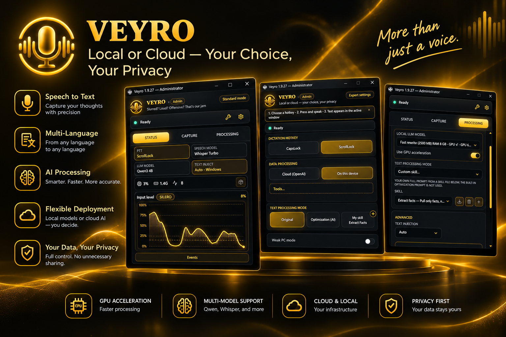

  <a href="README.md">English</a> | <strong>Русский</strong>

# Veyro

**Сайт:** [veyrotext.vercel.app](https://veyrotext.vercel.app)

**Veyro** — настольное приложение для голосового ввода. Вы говорите — приложение распознаёт речь и вставляет текст в активное окно: документ, чат, браузер или редактор кода.

Приложение работает в фоне и открывается из **системного трея** (Windows/Linux) или **строки меню** (macOS).

  

---

## Быстрый старт

1. Запустите Veyro и включите его в настройках.
2. Переключитесь в окно, куда нужно вставить текст.
3. Начните диктовку — распознанный текст автоматически попадёт в поле ввода.

### Режимы записи

| Режим | Поведение |
|------|----------|
| **Push-to-talk (PTT)** | Удерживайте горячую клавишу во время речи; отпустите — текст распознается и вставляется. Можно переключить на «нажал — начал / нажал — остановил». |
| **Непрерывный** | Говорите естественно; после паузы речь распознаётся и вставляется автоматически. |

Горячую клавишу можно настроить (по умолчанию: `Shift+F1`). На macOS поддерживается **Caps Lock как клавиша диктовки**.

В режиме PTT проигрываются короткие сигналы начала и конца записи.

---

## Распознавание речи

Два провайдера:

| Провайдер | Особенности |
|----------|--------|
| **На устройстве** | Работает офлайн. Модели загружаются из приложения. Ускорение на GPU (Vulkan, DirectML, CUDA, CoreML) ускоряет распознавание, когда доступно. |
| **OpenAI Cloud** | Транскрипция через API OpenAI. Нужен API-ключ и интернет. |

**Локальные семейства моделей** (настройки «Голос»):

- **Whisper** (whisper.cpp) — от Base до Large v3 / Turbo; широкая поддержка языков; квантования Q4/Q5/Q8.
- **Sherpa-onnx** — наборы **Parakeet TDT 0.6B v3** и **Qwen3-ASR** (INT8 / FP16 / FP32); английский или мультиязычность в зависимости от модели.

Язык распознавания: автоматически, русский, английский или другой фиксированный язык из списка.

**Детекция речи (VAD):** по умолчанию Silero VAD (с тихим предфильтром WebRTC); опционально только WebRTC. Порог можно задать вручную или автоматически, с калибровкой по микрофону.

**Словарь транскрипции** (`dictionary.toml`) помогает с именами, жаргоном и пользовательской лексикой.

---

## Обработка текста

После транскрипции текст можно дополнительно улучшить:

| Режим | Что делает |
|------|----------------|
| **Как есть** | Сырой результат STT |
| **Базовая правка** | Убирает слова-паразиты, исправляет пробелы и регистр |
| **AI-оптимизация** | ИИ убирает оговорки и ошибки ASR, сохраняя смысл |
| **Свой навык…** | Ваша цепочка обработки из файла навыка `.md` (официальный тон, краткость и т.д.) |

Для режимов с ИИ выбирается провайдер:

- **OpenAI** — через API (нужен ключ)
- **Локальная LLM** — модель на устройстве (загружается из приложения)

Опционально **Silero TE** добавляет расстановку пунктуации и улучшение текста на устройстве после STT (скачивается при включении).

Навыки можно импортировать с диска, из каталога в приложении или по deeplink `veyro://`; они хранятся в пользовательской папке **skills**.

### Дополнительные опции текста

- **Произносимая пунктуация** — «точка», «запятая» и т.д. вставляют знаки препинания
- **Числа словами** — например, `123` → «сто двадцать три» (зависит от локали)
- **Эмуляция Enter** — фразы вроде «новая строка» отправляют Enter

---

## Инструменты

Откройте **Инструменты** из главного окна настроек (или из строки статуса) — утилиты используют тот же движок речи и текстовый конвейер, что и живая диктовка.

### Обработка голосовых файлов

Транскрипция аудиофайлов в текст — очередь из нескольких файлов, чтение результата и копирование в буфер обмена. Используются текущий провайдер STT и режим текста (включая **AI-оптимизацию** и **пользовательские навыки**, если настроены).

- **Ввод:** перетаскивание или выбор файла — WAV, MP3, OGG/Opus, FLAC, M4A, AAC, WMA и другие распространённые форматы.
- **Прогресс:** для длинных файлов показываются этапы и процент выполнения.
- **Безопасность:** транскрипция файлов ждёт, пока активна PTT-диктовка; обрабатывается один файл за раз.
- **Автотранскрипция:** опциональный мониторинг папок «Загрузки» / Telegram Desktop (и своих). При включении новые `.ogg` / `.oga` / `.opus` автоматически попадают в очередь. Результаты — в **Истории голоса**, открыть можно из трея (**Недавние транскрипты**). По умолчанию выключено; только локальные модели; исходные файлы не удаляются.

### Аудио в субтитры (SRT)

Транскрипция с метками времени по сегментам и экспорт субтитров `.srt`.

- Предпросмотр на временной шкале с редактированием реплик.
- Расширенная вёрстка: умное разбиение, лимиты строк, опции «хвоста» чтения.
- Тот же провайдер STT и языковые настройки, что и при диктовке; если при **Авто** языке речь пустая, приложение может предложить фиксированный язык и повторить попытку.

### Разделение вокала / инструментала

Офлайн-разделение стемов для музыкальных треков — загружаемые ONNX-модели, интерфейс прогресса и предпросмотр/скачивание дорожек **вокала** и **инструментала**.

- Модели включают **Google ReFormer** (качество / скорость) и **Hybrid Transformer Demucs**.
- Показывается в «Инструментах», если сборка включает локальное разделение.

---

## Вставка текста

Распознанный текст попадает в активное окно через:

- **Буфер обмена** (вставка)
- **Эмуляцию нажатий клавиш**

На macOS для эмуляции клавиатуры нужно разрешение **Универсальный доступ** (Accessibility).

---

## Настройки

Два режима интерфейса:

| Режим | Для кого |
|------|----------|
| **Стандартный** | Упрощённые параметры захвата и текста |
| **Экспертный** | Полный контроль «Захват / Преобразование / Статус» |

Также доступно:

- **Микрофон** — выбор устройства и индикатор уровня
- **Язык интерфейса** — русский или английский
- **Запуск при входе в систему**
- **Уведомления** о событиях приложения
- **Расширенное аудио** — предобработка перед распознаванием, движок VAD и порог
- **Слабый ПК** — опциональная выгрузка очереди сегментов на диск при загрузке конвейера
- **Инструменты** — голосовые файлы, экспорт SRT и разделение стемов

На вкладке **Статус** — живая диагностика (CPU/RAM, чипы возможностей), график **уровня входа** с порогом VAD и сворачиваемый журнал активности.

---

## Конфиденциальность

- Ключи API OpenAI хранятся в **защищённом хранилище ОС** (Диспетчер учётных данных Windows, Связка ключей macOS, Secret Service в Linux), а не в открытом виде.
- При **локальных моделях речи** (Whisper, Parakeet TDT, Qwen3-ASR через sherpa-onnx), **локальной LLM** и **Silero TE** речь и текст остаются на вашем компьютере.
- Разделение стемов тоже выполняется **на устройстве** (ONNX); аудио для этого инструмента не загружается в облако.
- Настройки хранятся в профиле пользователя (`AppData\Veyro` в Windows, аналогичные пути в macOS и Linux).

---

## Платформы

| ОС | Форматы установки |
|----|-------------------|
| **Windows** | NSIS-установщик, portable `.exe` |
| **macOS** | `.app`, `.dmg` (macOS 11+) |
| **Linux** | `.deb`, AppImage |

Установщики — в **[GitHub Releases](https://github.com/WtekSupport/veyro/releases)**.

Установленные сборки могут проверять подписанные обновления при запуске. См. [docs/UPDATER.md](docs/UPDATER.md).

---

## Сборка из исходников

- English: [docs/BUILD.en.md](docs/BUILD.en.md)
- Русский: [docs/BUILD.md](docs/BUILD.md)

---

## Участие в проекте

Мы принимаем pull request'ы. Прочитайте [CONTRIBUTING.md](CONTRIBUTING.md) и [CODE_OF_CONDUCT.md](CODE_OF_CONDUCT.md). Сообщения об уязвимостях: [`.github/SECURITY.md`](.github/SECURITY.md).

---

## Лицензия

[MIT](LICENSE) · © 2026 MKdee Tech
